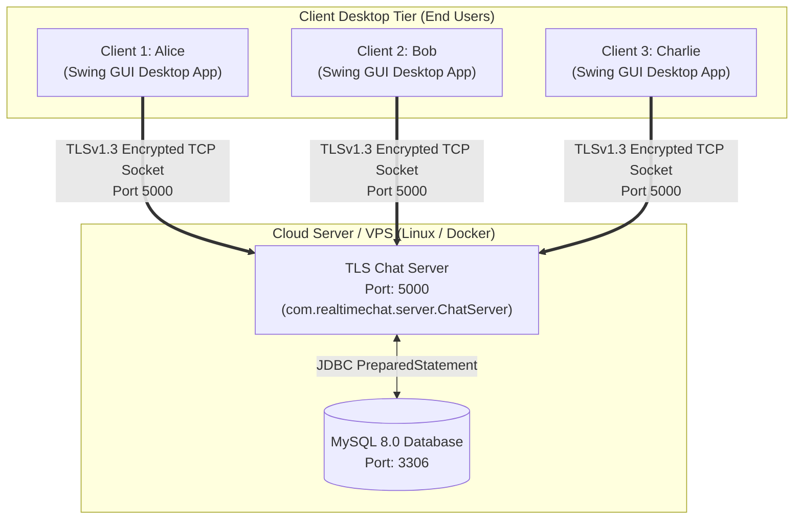

# 🚀 Real-Time Chat System - Complete Production Deployment Guide

This document provides end-to-end instructions for deploying the **Real-Time Chat Application** across various environments: from **Docker containers** and **Cloud VPS servers (AWS, DigitalOcean, GCP)** to **Local Area Networks (LAN / College Labs)** and **Standalone Desktop Client Distribution**.

---

## 🏗️ Architectural Topology

The application is structured into two core deployment tiers:



---

## 📦 Strategy 1: One-Click Docker & Docker Compose Deployment (Recommended for Cloud)

The fastest and most reliable way to deploy the entire backend (Server + Database) on any Linux server, VPS, or local machine with Docker installed.

### Prerequisites
- Docker Engine 20.10+
- Docker Compose v2+

### 1. Launch Services
Clone the repository on your server and run:
```bash
docker compose up -d --build
```

### 2. Verify Deployment
Check that both containers are running and healthy:
```bash
docker compose ps
```
*Expected Output:*
```text
NAME                   IMAGE                  COMMAND                  SERVICE       STATUS
realtime-chat-mysql    mysql:8.0              "docker-entrypoint.s…"   mysql         Up (healthy)
realtime-chat-server   simplechatbot-server   "java -jar /app/chat…"   chat-server   Up (healthy)
```

### 3. View Live Logs
Stream real-time server connection and routing logs:
```bash
docker compose logs -f chat-server
```

### 4. Stop Services
```bash
docker compose down
```
*(Database data is safely preserved in the named Docker volume `mysql-data`)*

---

## 🖥️ Strategy 2: Standalone Desktop Client Distribution (For End Users)

The project includes an **executable Fat JAR** containing all runtime dependencies (Gson, BCrypt, MySQL Connector) and embedded TLS truststores.

### 1. Build the Distribution JAR
Run the Maven package command from the project root:
```bash
mvn clean package -DskipTests
```
This produces:
```text
target/realtime-chat-app-1.0-SNAPSHOT.jar (~4.8 MB)
```

### 2. Distributing to End Users
Send the single `.jar` file to clients (Windows, macOS, or Linux).

- **How Users Launch the Client:**
  - **Double-click:** Simply double-click `realtime-chat-app-1.0-SNAPSHOT.jar` (if Java 17+ is installed).
  - **Terminal / Command Prompt:**
    ```bash
    java -jar realtime-chat-app-1.0-SNAPSHOT.jar client
    ```

### 3. Connecting to a Remote Deployed Server
In the **Sign In** window:
- **Server Host:** Change `localhost` to the Public IP or Domain Name of your deployed server (e.g., `chat.yourdomain.com` or `13.233.54.120`).
- **Server Port:** `5000`
- **Username / Password:** Log in with your registered account credentials.

---

## ☁️ Strategy 3: Production Linux VPS Deployment (Ubuntu 22.04 / 24.04 on AWS / DigitalOcean / GCP)

Follow these steps to deploy directly on a native Linux virtual machine.

### Step 1: Install OpenJDK 17 and MySQL Server
```bash
sudo apt update && sudo apt upgrade -y
sudo apt install -y openjdk-17-jre-headless mysql-server git ufw
```

### Step 2: Configure MySQL Database
1. Secure and open MySQL:
   ```bash
   sudo mysql
   ```
2. Create database, user, and grant privileges:
   ```sql
   CREATE DATABASE realtime_chat CHARACTER SET utf8mb4 COLLATE utf8mb4_unicode_ci;
   CREATE USER 'chatuser'@'localhost' IDENTIFIED BY 'StrongChatPass_2026!';
   GRANT ALL PRIVILEGES ON realtime_chat.* TO 'chatuser'@'localhost';
   FLUSH PRIVILEGES;
   EXIT;
   ```
3. Initialize tables using the schema:
   ```bash
   mysql -u chatuser -p realtime_chat < database/schema.sql
   ```

### Step 3: Deploy Application Binary
1. Transfer `realtime-chat-app-1.0-SNAPSHOT.jar` to `/opt/realtime-chat/`:
   ```bash
   sudo mkdir -p /opt/realtime-chat
   sudo cp target/realtime-chat-app-1.0-SNAPSHOT.jar /opt/realtime-chat/chat-server.jar
   ```

### Step 4: Configure `systemd` Service (Auto-Start & Crash Recovery)
Create a systemd unit file at `/etc/systemd/system/chat-server.service`:
```ini
[Unit]
Description=Real-Time Chat TLS Server
After=network.target mysql.service

[Service]
Type=simple
User=ubuntu
WorkingDirectory=/opt/realtime-chat
Environment="DB_URL=jdbc:mysql://localhost:3306/realtime_chat?useSSL=false&serverTimezone=UTC&allowPublicKeyRetrieval=true"
Environment="DB_USER=chatuser"
Environment="DB_PASSWORD=StrongChatPass_2026!"
ExecStart=/usr/bin/java -jar /opt/realtime-chat/chat-server.jar server
Restart=always
RestartSec=5
StandardOutput=journal
StandardError=journal

[Install]
WantedBy=multi-user.target
```

Enable and start the service:
```bash
sudo systemctl daemon-reload
sudo systemctl enable chat-server
sudo systemctl start chat-server
```

Check status:
```bash
sudo systemctl status chat-server
sudo journalctl -u chat-server -f
```

### Step 5: Configure Firewall & Security Groups
1. Enable UFW on Ubuntu:
   ```bash
   sudo ufw allow ssh
   sudo ufw allow 5000/tcp comment 'Real-Time Chat TLS Port'
   sudo ufw enable
   ```
2. **Cloud Security Groups (AWS EC2 / DigitalOcean / GCP):**
   Add an **Inbound Rule** in your cloud provider's console:
   - **Type:** Custom TCP
   - **Port Range:** `5000`
   - **Source:** `0.0.0.0/0` (Anywhere)

---

## 🌐 Strategy 4: Local Area Network (LAN) / College Lab Demonstration

To run the system across different physical PCs connected to the same Wi-Fi router or lab network:

1. **On the Server PC (Host):**
   - Find your LAN IP address:
     - Open Command Prompt and run `ipconfig`.
     - Note the **IPv4 Address** (e.g., `192.168.1.15`).
   - Run `run-server.bat` (or `java -jar target/realtime-chat-app-1.0-SNAPSHOT.jar server`).
   - Ensure Windows Defender Firewall allows Port 5000:
     ```powershell
     New-NetFirewallRule -DisplayName "ChatServer 5000" -Direction Inbound -Protocol TCP -LocalPort 5000 -Action Allow
     ```

2. **On Other Client PCs:**
   - Copy `target/realtime-chat-app-1.0-SNAPSHOT.jar` (or the project folder with `run-client.bat`).
   - Open the client GUI.
   - Set **Server Host** to the Host PC's IP (e.g., `192.168.1.15`).
   - Set **Port** to `5000`.
   - Log in or Register!

---

## ☁️ Strategy 5: Free Cloud Hosting Options for Sockets

Standard free web hosts (Vercel, Netlify, GitHub Pages) **only support HTTP/HTTPS static web apps** and cannot host persistent stateful TCP sockets. The following free cloud services support raw TCP sockets:

| Platform | Type | Free Tier Specs | TCP Socket Support |
| :--- | :--- | :--- | :--- |
| **Oracle Cloud Always Free** | Linux VPS (VM) | 2 AMD VMs or 4-core 24GB Ampere ARM, Public IP | ✅ Native TCP on port 5000 |
| **Railway.app** | Container Platform | $5 monthly free credit, TCP Proxy support | ✅ Yes (Generates a public TCP domain:port) |
| **Fly.io** | Container Platform | 3 shared-cpu-1x VMs, Any TCP port | ✅ Yes (Configure via `fly.toml`) |
| **AWS Free Tier (EC2)** | Virtual Machine | 750 hrs/month `t2.micro`/`t3.micro` for 12 months | ✅ Native TCP on port 5000 |

---

## 🛠️ Verification & Smoke Testing Checklist

After deploying the server, verify health with:

1. **Port Connectivity Check:**
   ```bash
   # From any terminal
   nc -zv <SERVER_IP> 5000
   # Or using PowerShell
   Test-NetConnection -ComputerName <SERVER_IP> -Port 5000
   ```
2. **TLS Handshake Verification:**
   ```bash
   openssl s_client -connect <SERVER_IP>:5000 -tls1_3
   ```
3. **End-to-End Chat Verification:**
   - Launch Client 1: Register `alice`, log in.
   - Launch Client 2: Register `bob`, log in.
   - Confirm real-time online badge appears on both clients.
   - Send messages and confirm instant bubble rendering.
