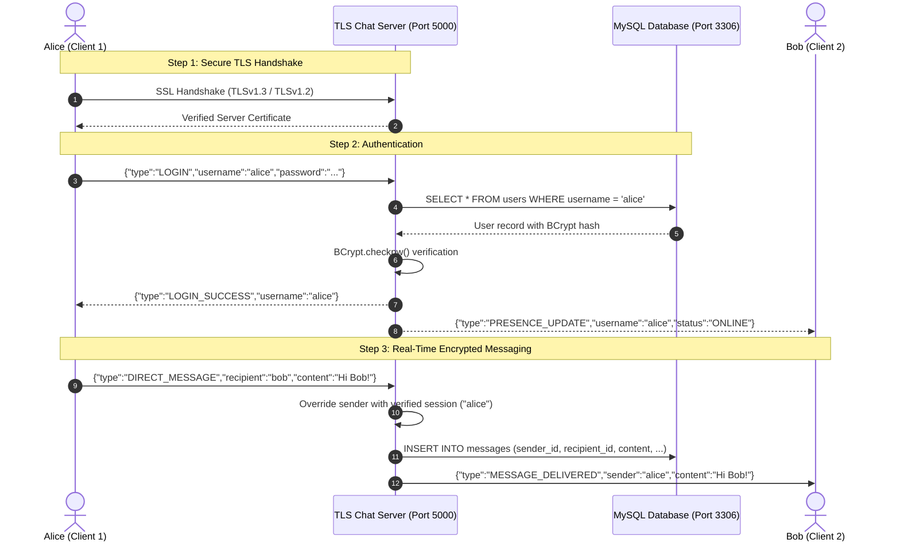

# 💬 Real-Time Chat Application Using Java Socket Programming

<div align="center">

[](https://github.com/Dhanushree-1977/Basic-Chat-Application-Mini-project-2-/actions/workflows/ci.yml)
[](https://adoptium.net/)
[](https://maven.apache.org/)
[](https://www.mysql.com/)
[](https://en.wikipedia.org/wiki/Transport_Layer_Security)
[](https://www.docker.com/)
[](LICENSE)

*An enterprise-grade, secure, multi-threaded desktop chat system engineered with **Java TCP Sockets**, **TLSv1.3 PKCS#12 encryption**, **Modern Glassmorphic Swing GUI**, **MySQL 8.0 persistence**, and **BCrypt authentication**.*

</div>

---

## 🌟 Key Highlights

- 🔐 **End-to-End Transport Encryption (TLSv1.3):** Every byte exchanged over port `5000` is secured via `SSLServerSocket` and `SSLSocket` using PKCS#12 keystores and truststores. Cleartext fallback is strictly prohibited.
- 🎨 **Modern Glassmorphism Desktop GUI:** Handcrafted Java Swing interface featuring an aurora gradient mesh backdrop, frosted translucent acrylic cards, glowing active fields, custom message bubbles, and real-time online presence indicators.
- ⚡ **Multi-Session Presence & Instant Routing:** Cached thread pool (`ExecutorService`) handles concurrent client connections with dynamic message routing, multi-session deduplication, and offline message queueing.
- 🛡️ **Zero-Trust Sender Protection:** The server enforces server-side identity injection—client payloads cannot spoof senders. Passwords are hash-protected with **BCrypt (12 salt rounds)**.
- 🗄️ **Persistent MySQL Archival:** Complete relational persistence for users and message histories with parameterized `PreparedStatement` ensuring 100% immunity to SQL injection.
- 🐳 **Docker & Docker Compose Ready:** Launch the entire backend server and MySQL database with a single command: `docker compose up -d`.
- 📦 **Standalone Executable Fat JAR:** Shaded single-file distribution (`realtime-chat-app-1.0-SNAPSHOT.jar`, ~4.8 MB) runnable on any OS with Java 17+ installed.

---

## 🏗️ Architecture & Protocol Flow



---

## 📁 Repository Structure

```text
Basic-Chat-Application-Mini-project-2-/
├── .github/
│   ├── workflows/
│   │   ├── ci.yml                 # Automated Maven test & Fat JAR packaging
│   │   └── release.yml            # Automated GitHub Release builder
│   ├── ISSUE_TEMPLATE/
│   │   ├── bug_report.md
│   │   └── feature_request.md
│   └── pull_request_template.md
├── database/
│   └── schema.sql                 # MySQL schema (users & messages tables)
├── lib/                           # Self-contained offline dependency JARs
├── src/
│   ├── main/
│   │   ├── resources/
│   │   │   ├── db.properties.example
│   │   │   ├── schema.sql
│   │   │   └── security/
│   │   │       ├── server.keystore    # PKCS#12 Server Private Key & Cert
│   │   │       ├── client.truststore  # PKCS#12 Client TrustStore
│   │   │       └── server.cer
│   │   └── java/com/realtimechat/
│   │       ├── Main.java              # Unified application launcher
│   │       ├── LiveDemonstration.java # 7-phase end-to-end automated test demo
│   │       ├── server/                # ChatServer, ClientHandler, ClientManager
│   │       ├── client/                # ChatClient, ClientNetworkService
│   │       ├── ui/                    # GlassUtils, LoginFrame, RegisterFrame, ChatFrame
│   │       ├── model/                 # Message, MessageType, User, StoredMessage
│   │       ├── database/              # DatabaseConnection, UserRepository, MessageRepository
│   │       └── service/               # AuthService, Router, Presence, Notifications
│   └── test/java/com/realtimechat/   # JUnit 5 test suite
├── Dockerfile                     # Multi-stage container build
├── docker-compose.yml             # Full-stack Docker orchestration
├── DEPLOYMENT.md                  # Comprehensive Cloud/VPS/LAN deployment guide
├── CONTRIBUTING.md                # Developer contribution guidelines
├── CODE_OF_CONDUCT.md            # Community code of conduct
├── SECURITY.md                   # Security vulnerability reporting policy
├── run-all.bat                    # Windows 1-click launcher (Server + 2 Clients)
├── run-server.bat                 # Windows Server launcher
├── run-client.bat                 # Windows Client launcher
├── run-demo.bat                   # Windows Live Demo runner
├── run-tests.bat                  # Windows JUnit 5 runner
├── run-all.sh                     # Linux/macOS 1-click launcher
├── run-server.sh                  # Linux/macOS Server launcher
├── run-client.sh                  # Linux/macOS Client launcher
├── pom.xml                        # Maven dependency & shade build configuration
└── README.md
```

---

## 🚀 Quick Start Guide

### Prerequisites
- **Java SE Development Kit (JDK):** Version 17 or higher
- **MySQL Server:** Version 8.0 or higher
- **Apache Maven:** 3.8+ (Optional, Maven wrapper or pre-built JAR can be used)

---

### Step 1: Database Setup
1. Open your MySQL client (Workbench or terminal):
   ```bash
   mysql -u root -p < database/schema.sql
   ```
2. Copy the template and add your MySQL password:
   ```bash
   cp src/main/resources/db.properties.example src/main/resources/db.properties
   ```
   *Edit `src/main/resources/db.properties` with your MySQL user and password.*

---

### Step 2: One-Click Launch

#### On Windows:
Double-click **`run-all.bat`** (or execute from terminal):
```cmd
run-all.bat
```
*This launches:*
1. The **TLS Server** on port `5000`.
2. **Client 1** (`LoginFrame` for Alice).
3. **Client 2** (`LoginFrame` for Bob).

#### On Linux / macOS:
```bash
chmod +x *.sh
./run-all.sh
```

---

### Step 3: Manual Execution via Standalone Executable Fat JAR

Package the application:
```bash
mvn clean package -DskipTests
```

Run any component using standard `java -jar`:
```bash
# 1. Start Server on Port 5000:
java -jar target/realtime-chat-app-1.0-SNAPSHOT.jar server

# 2. Launch Client 1:
java -jar target/realtime-chat-app-1.0-SNAPSHOT.jar client

# 3. Launch Client 2:
java -jar target/realtime-chat-app-1.0-SNAPSHOT.jar client

# 4. Run Automated 7-Phase Live Demonstration:
java -jar target/realtime-chat-app-1.0-SNAPSHOT.jar demo
```

---

## 🐳 Docker Deployment

To deploy the entire server and database stack in containers:

```bash
docker compose up -d --build
```

- **Server Port:** `5000` (TLS)
- **Database Port:** `3306` (MySQL 8.0)
- **Logs:** `docker compose logs -f chat-server`

For detailed production cloud setups (AWS EC2, DigitalOcean, Ubuntu systemd, LAN setups), see [**`DEPLOYMENT.md`**](DEPLOYMENT.md).

---

## 🧪 Running Unit Tests

Run the JUnit 5 test suite using Maven:
```bash
mvn test
```

Or using the included zero-setup Maven wrapper:
```bash
./mvnw test        # macOS / Linux
.\mvnw.cmd test    # Windows
```

Or using the standalone offline test runner on Windows:
```cmd
run-tests.bat
```

---

## 👥 Authors & Maintainers

- **Dhanushree V M** ([@Dhanushree-1977](https://github.com/Dhanushree-1977)) - *Lead Developer & Architect*

---

## 📄 License

This project is licensed under the MIT License - see the [LICENSE](LICENSE) file for details.
